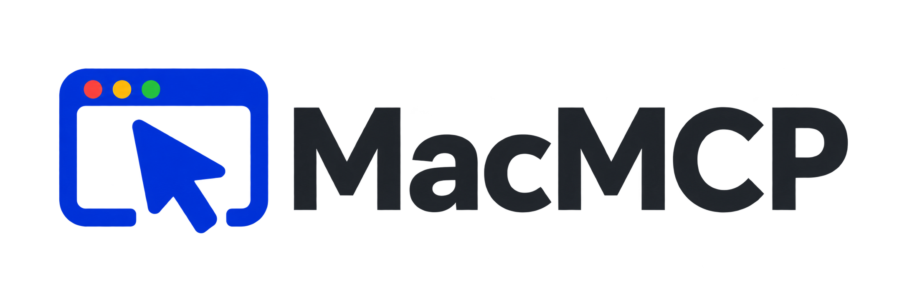

<div align="center">

<h1>
  <picture>
    <source media="(prefers-color-scheme: dark)" srcset="assets/branding/macmcp-wordmark-dark.png">
    
  </picture>
</h1>

**Reliable, efficient Mac control for AI agents.**

A [Model Context Protocol](https://modelcontextprotocol.io) server that lets agents (Claude Code, Codex, scripts, or
agents on other machines over SSH) see and drive macOS apps through the accessibility tree. It uses element references,
verified actions and settle-aware waits instead of blind coordinate clicks.

[](https://modelcontextprotocol.io)
[](https://www.swift.org/)
[](#requirements)
[](#status)
[](LICENSE)

</div>

---

## What it looks like

An agent reads the UI as compact rows with refs, acts on a ref, and gets back what changed:

```text
> mac_snapshot app="MacMCPTestHost"
app: MacMCPTestHost (com.playbacksoftware.macmcp.testhost) · window "MacMCP Test Host" · focus: e1 · snapshot s1
heading "Order Form"
e1 textfield "Name" = "" [focused]
e5 popup "Size" = "Small"
e6 button "Submit"
text "Nothing submitted yet."
…

> mac_type ref=e1 text="Ada Lovelace"
into e1 textfield "Name": typed 12 characters; field value verified · settled in 369 ms
~ e1 textfield "Name": value "" → "Ada Lovelace"

> mac_click ref=e6
clicked e6 button "Submit" (accessibility press) · settled in 457 ms
+ text "Submitted: Ada Lovelace, Small, toppings: none"
- text "Nothing submitted yet."
```

## Highlights

- **Refs, not guesses.** Every action re-resolves its target, hit-tests before clicking, verifies typed text and
  answers with a diff, so agents rarely need a screenshot.
- **Settle-aware.** Actions return once the UI goes quiet, and `mac_wait` waits for conditions instead of fixed sleeps.
- **Permissions that stick.** A signed `MacMCP.app` LaunchAgent holds the Accessibility and Screen Recording grants,
  so they survive rebuilds and work for clients started over SSH.
- **Works over SSH.** `ssh my-mac ~/.local/bin/mac-mcp` gives a remote agent the same tools. Several sessions can connect; only one
  drives the GUI at a time.
- **More than clicks.** Menu commands by path, AppleScript in apps you allow, your Shortcuts, OCR for canvases, and
  `web_*` tools for a separate automation Safari.
- **Safe and self-diagnosing.** A per-machine policy, an audit log, deadlines on every call, and `mac-mcp doctor`
  for problems and their fixes. See [Safety](#safety).

## Tools

| Group | Tools |
| --- | --- |
| See | `mac_snapshot`, `mac_screenshot` (with OCR), `mac_wait` |
| Act | `mac_click`, `mac_type`, `mac_key`, `mac_scroll`, `mac_drag`, `mac_hover` |
| Direct routes | `mac_menu`, `mac_script`, `mac_shortcut`, `mac_clipboard` |
| Apps and windows | `mac_app`, `mac_window`, `mac_doctor` |
| Web (Safari) | `web_navigate`, `web_read`, `web_act`, `web_tabs`, `web_dialog`, `web_logs`, `web_eval` |

The [tool reference](docs/tools.md) describes each one.

## Requirements

- macOS 26 or later on Apple silicon, and Xcode 26 or later (Swift 6.1+) to build.
- A person logged in at the Mac's console with the screen unlocked while agents work. Screen Sharing is fine.
- For the `web_*` tools: Safari 27, with Safari ▸ Settings ▸ Developer ▸ "Allow remote automation and external
  agents" turned on once. The Developer tab appears after Settings ▸ Advanced ▸ "Show features for web developers".
- Any stdio MCP client, such as [Claude Code](https://code.claude.com/docs/en/mcp).

## Quick start

```bash
scripts/setup-signing.sh   # once: a signing certificate in a dedicated keychain
scripts/build.sh           # build, sign and install ~/Applications/MacMCP.app and ~/.local/bin/mac-mcp, start the agent
mac-mcp doctor             # check permissions and the session
```

The CLI is installed in `~/.local/bin`; add it to your `PATH` or use the full path.

macOS ties permission grants to the signing certificate, so MacMCP needs one that stays the same across builds.
`setup-signing.sh` creates a self-signed one, or imports yours with `--import`. If your login keychain has exactly one
valid code-signing identity, such as an Apple Development certificate from Xcode, `build.sh` uses it from a local
Terminal without this step. With several, it stops and lists them; set `MAC_MCP_SIGNING_IDENTITY` to the SHA-1 of the one
you want. See [Signing](docs/architecture.md#signing).

On first launch macOS asks you to grant **MacMCP** *Accessibility* (shown as "Device Control" on macOS 27) and
*Screen & System Audio Recording*. Approve both, then run `mac-mcp doctor` until everything reads `OK`.

Connect a client on the Mac itself, or from another machine over SSH:

```bash
claude mcp add mac -- ~/.local/bin/mac-mcp
claude mcp add mac -- ssh you@your-mac /Users/you/.local/bin/mac-mcp
```

`mac-mcp remote-setup` checks this Mac and prints the exact commands for another machine.

### A first task

Once the client is connected, give it something small and read-only:

> Use the mac tools to list the running apps, then snapshot the frontmost window and tell me what's on screen.

Then something that acts:

> Open Calculator, work out 17 × 23 and tell me what it shows.

If a call is refused, `mac-mcp doctor` and the tool's reply say why; [Policy and security](docs/policy-and-security.md)
covers the defaults.

## Updating

```bash
git pull
scripts/build.sh           # builds, swaps the install in and rolls back if the new agent doesn't answer
mac-mcp doctor
```

Permissions carry over while the signing certificate stays the same. `build.sh` won't replace the agent while another
client holds the GUI lease. See the [changelog](CHANGELOG.md) for what changed between releases.

## Uninstalling

```bash
mac-mcp uninstall --purge   # stops the agent, removes its LaunchAgent, ~/Applications/MacMCP.app and its support folder
rm ~/.local/bin/mac-mcp
```

`--purge` also deletes the approved-policy records from your login keychain (macOS may ask for its password).
Without it, only the LaunchAgent is removed. Neither touches `~/.config/mac-mcp` (your policy), `~/Library/Logs/MacMCP`
(logs and the audit log) or the signing keychain `~/Library/Keychains/mac-mcp-signing.keychain-db`; delete those yourself
if you want them gone. Remove MacMCP from System Settings ▸ Privacy & Security ▸ Accessibility and Screen & System Audio
Recording, and from your MCP client (`claude mcp remove mac`).

## Safety

MacMCP lets an AI agent operate your Mac as you. Run it on a Mac, or under an account, where that's acceptable, and
read [Policy and security](docs/policy-and-security.md) before you give it real work.

- **Policy.** `~/.config/mac-mcp/policy.json` decides which apps agents may see and drive. By default they can't
  touch terminals, launchers and automation apps, Shortcuts, Keychain Access, password managers or System Settings,
  and AppleScript, Shortcuts, page JavaScript and private-network URLs are off until you allow them. A change that
  loosens the policy applies only after you run `mac-mcp policy approve` in Terminal, which records it in your login
  keychain.
- **Refusals.** Agents can't answer macOS security prompts, read password fields or passwords copied from a password
  manager, open launchers by side routes (the Dock, Finder, Services, `open=`), or touch MacMCP's own files, keychains,
  SSH keys, credentials or shell startup files. Allowed scripts run behind an Apple-event gate. Screen and web text is
  marked as untrusted data with a per-response token that page text can't forge.
- **Audit log.** Every call is recorded in `~/Library/Logs/MacMCP/audit.jsonl`, with typed text, keys, script source
  and URL secrets redacted. `mac-mcp report` summarises it.
- **Local by design.** The socket is owner-only, there is no network listener, and remote access goes through SSH.

Found a way around these? Please report it privately; see [SECURITY.md](SECURITY.md).

## Status

Early development: tools and policy keys may still change before 1.0.

## Documentation

| Document | Contents |
| --- | --- |
| [Tools](docs/tools.md) | Tool reference and an example snapshot |
| [Architecture](docs/architecture.md) | Agent and relay design, protocol layer, web tools, health checks, GUI sharing, signing |
| [Policy and security](docs/policy-and-security.md) | `policy.json` options and the security model |
| [Development and testing](docs/testing/development.md) | Unit, integration and soak tests, the TestHost app, and the agent task suite |

## License

MIT — see [LICENSE](LICENSE). Copyright © 2026 Playback Software, LLC.
